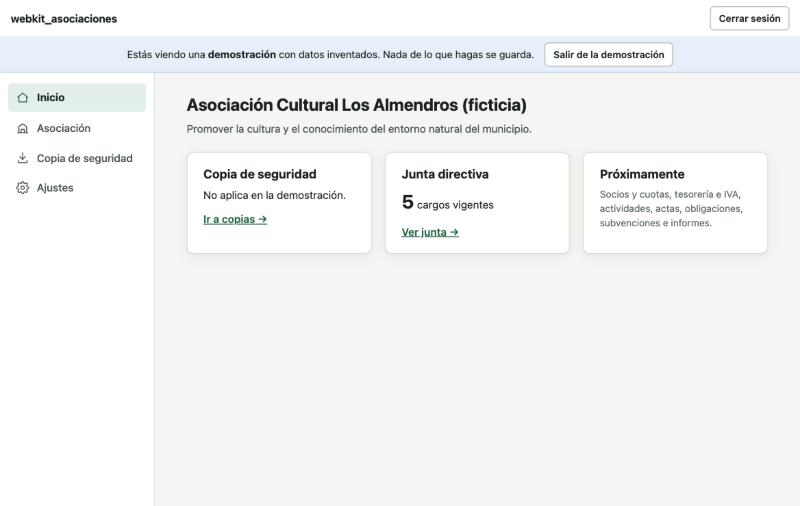
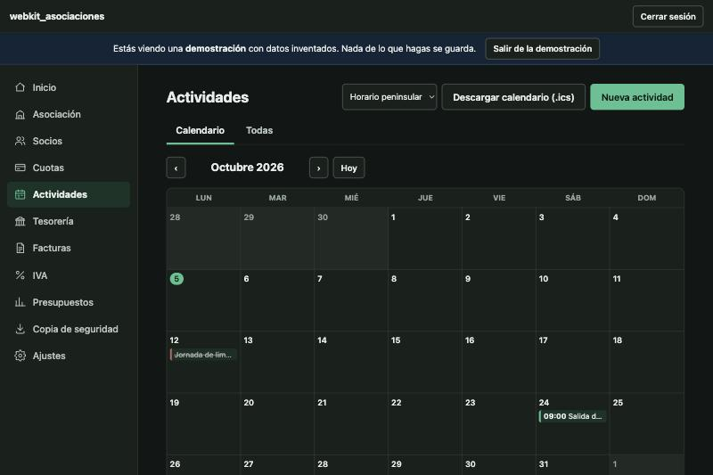

# webkit_asociaciones

**Gestión de una asociación sin ánimo de lucro en un solo archivo HTML.** Sin instalar nada, sin crear cuentas, sin pagar plataformas y sin que los datos de los socios salgan de tu ordenador.

Pensada para asociaciones pequeñas de España (sin personal contratado, de 50 a 150 socios y unos pocos miles de euros al año) que hoy se apañan con hojas de cálculo.

> ⚠️ **Estado: en desarrollo (versión 0.6, las 6 fases hechas).** Incluye datos de la asociación, junta directiva, socios y cuotas, tesorería, facturas, ayuda para el IVA, presupuestos, actividades con calendario, libro de actas, calendario de obligaciones, seguimiento de subvenciones, documentos adjuntos cifrados, **memoria anual, cuentas del ejercicio y panel de resumen con gráficas**, copias de seguridad cifradas y ajustes. Faltan las convocatorias de asamblea (pendientes de definir). Ver la [hoja de ruta](#hoja-de-ruta).

| Inicio | Socios | Actividades | Móvil (tema oscuro) |
|---|---|---|---|
|  |  |  |  |

*(Capturas con los datos de demostración: todo es inventado.)*

## Cómo se usa

1. Descarga el archivo [`dist/webkit_asociaciones.html`](dist/webkit_asociaciones.html).
2. Ábrelo con doble clic. Funciona sin conexión a internet.
3. Elige una de estas opciones:
   - **Empezar con datos nuevos**: eliges una contraseña, que cifrará los datos.
   - **Recuperar una copia de seguridad**: si ya la usabas en otro ordenador.
   - **Probar con datos de demostración**: datos inventados que no se guardan.
4. Descarga una **copia de seguridad** a menudo, desde «Copia de seguridad», y guárdala fuera del ordenador.

### Dónde están tus datos

- Se guardan **en el navegador** con el que abres el archivo, **cifrados con tu contraseña** (AES-256). Ningún dato sale de tu ordenador: la aplicación no se conecta a ningún servidor.
- Si **olvidas la contraseña**, nadie puede recuperar los datos. Apúntala en un lugar seguro.
- Si abres el archivo con **otro navegador**, en **otro ordenador** o después de **moverlo de carpeta**, puede aparecer vacío. Los datos no se han perdido: recupéralos con tu copia de seguridad.
- La copia de seguridad es un archivo `.json` **cifrado con la misma contraseña**.

## Qué hace (y qué hará)

### Hoja de ruta

| Fase | Contenido | Estado |
|---|---|---|
| 1. Base y datos | Datos de la asociación y junta directiva, almacenamiento cifrado, copias de seguridad, demostración, tema claro/oscuro, diseño adaptado al móvil | ✅ Hecha |
| 2. Socios | Libro de registro de socios (ficha completa, altas, bajas, menores con tutor, consentimientos), búsqueda y filtros, importar/exportar CSV, tipos de socio con su cuota y periodicidad, emisión de cuotas por periodo, cobro por forma de pago (una o varias a la vez), devoluciones, impagados | ✅ Hecha |
| 3. Tesorería | Cuentas y saldos, movimientos a mano o importando el extracto del banco (CSV o Excel) con reglas y conciliación con cuotas y facturas; facturas emitidas (numeración, PDF) y recibidas (con retención); anticipos y reembolsos; ayuda para el 303 trimestral y el resumen anual (sujeto, exento, no sujeto; «a compensar» frente a «a devolver»); presupuesto anual y por proyecto o subvención; exportar a Excel | ✅ Hecha |
| 4. Actividades | Calendario mensual; actividades abiertas o solo para socios; inscripciones con aforo, lista de espera (sube sola), cobro (entra en tesorería sin duplicarse), asistencia, menores y autorizaciones; hoja de asistencia imprimible; exportar a .ics; balance económico por actividad | ✅ Hecha |
| 5. Gobierno | Libro de actas por órgano (junta, coordinación, asamblea, departamentos) con orden del día, asistentes, acuerdos y votaciones, versión para firmar y libro de acuerdos; calendario de obligaciones (fiscales, asociativas, renovaciones) con aviso; seguimiento de subvenciones (estado, plazos, requisitos); documentos adjuntos cifrados. *Convocatorias: pendientes de definir* | ✅ Hecha (salvo convocatorias) |
| 6. Informes | Memoria anual (entidad y junta, socios por tipo, sexo y edad, actividades y participación, proyectos y subvenciones, actas y acuerdos, resumen económico, textos propios) y cuentas del ejercicio (ingresos y gastos frente al año anterior, saldos, presupuesto, pendientes a 31/12, estado de situación simplificado y aproximación al modelo de entidades sin fines lucrativos), imprimibles en PDF; panel de Inicio con agenda, dinero, socios y cuotas y gráficas de 12 meses | ✅ Hecha |
| Futuro | Versión con servidor (acceso de socios, pagos en línea). Solo diseñada | — |

## Limitaciones (léelas)

- **No es asesoramiento legal ni fiscal.** Donde la aplicación toca normativa (Ley Orgánica 1/2002 de asociaciones, RGPD, obligaciones contables y fiscales), lo hace de forma orientativa. Verifica siempre con una asesoría.
- **Un solo navegador y un solo ordenador a la vez.** No hay sincronización: para pasar los datos de un ordenador a otro, usa la copia de seguridad. Si dos personas editan en sitios distintos, sus cambios no se juntan.
- **Varias copias del archivo en el mismo navegador comparten los datos.** El navegador guarda los datos por «sitio», y todos los archivos locales cuentan como el mismo sitio. Si llevas dos asociaciones, usa un navegador (o un perfil de navegador) distinto para cada una.
- **El navegador puede borrar los datos** si se borra el historial o los datos de navegación, o si falta espacio. Por eso son imprescindibles las copias de seguridad.
- **Documentos adjuntos:** se guardan cifrados en el navegador y van dentro de la copia de seguridad, que crece con ellos. Máximo 10 MB por archivo (configurable). Necesitan IndexedDB.
- **Calendario de obligaciones:** fechas orientativas, editables; verificad con la asesoría qué os afecta.
- **Tesorería por criterio de caja** (el dinero cuenta cuando entra o sale, con el IVA incluido). Las cuentas anuales formales pueden necesitar otro criterio: verificar con asesoría.
- **Las cuentas del ejercicio son un informe para la asamblea, no las cuentas anuales oficiales.** Salen de la tesorería (criterio de caja). La agrupación en el modelo de entidades sin fines lucrativos es una aproximación orientativa (cada categoría se puede asignar a mano). Verificar con asesoría.
- **La ayuda del IVA es orientativa.** Suma lo que hay en las facturas; no calcula la prorrata (se indica el porcentaje a mano) ni presenta nada. Revisadlo con la asesoría.
- **Extractos del banco:** se leen CSV y Excel moderno (.xlsx). Los .xls antiguos hay que guardarlos antes como .xlsx o .csv.
- **Probado en Chrome y en navegadores Chromium (Brave, Edge) abriendo el archivo directamente.** Falta probar Safari y Firefox con `file://`.

## Privacidad y RGPD

Los datos personales nunca salen del navegador: no hay servidores, ni analítica, ni recursos externos. Aun así, la asociación es responsable de los datos de sus socios. En **Ajustes → Privacidad** hay una lista de buenas prácticas: quién accede, contraseñas, copias cifradas y conservación de datos.

Para ordenadores compartidos, en **Ajustes** puedes activar «Borrar los datos de este navegador al cerrar la sesión».

## Para desarrollar

No hace falta instalar dependencias. Solo [Node.js](https://nodejs.org) 20 o posterior para los tests y el empaquetado.

```bash
# Abrir la versión de desarrollo: basta con abrir src/index.html en el navegador.
npm test          # tests de la lógica (dinero, fechas, NIF/IBAN, cifrado, copias…)
npm run build     # genera dist/webkit_asociaciones.html (un único archivo)
npm run comprobar # tests + comprobar que dist/ está al día (lo que hace la integración continua)
npm run probar-file # abre dist/ con file:// en Chrome/Brave/Edge sin interfaz (perfil temporal) y comprueba que guarda
```

Cómo está organizado el código: ver [CONTEXT.md](CONTEXT.md). Cómo contribuir: ver [CONTRIBUTING.md](CONTRIBUTING.md).

## Licencia

**Software privativo. Todos los derechos reservados.** No se concede ninguna licencia de uso, copia, modificación ni distribución sin autorización por escrito del titular. Ver [LICENSE](LICENSE).
