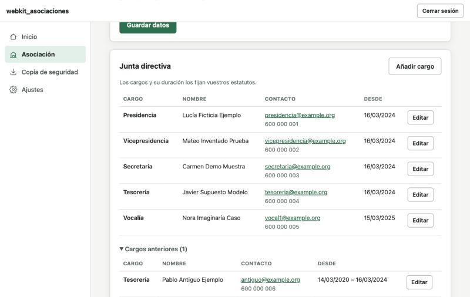

# webkit_asociaciones

**Gestión de una asociación sin ánimo de lucro en un solo archivo HTML.** Sin instalar nada, sin crear cuentas, sin pagar plataformas y sin que los datos de los socios salgan de tu ordenador.

Pensada para asociaciones pequeñas de España (sin personal contratado, de 50 a 150 socios y unos pocos miles de euros al año) que hoy se apañan con hojas de cálculo.

> ⚠️ **Estado: en desarrollo (versión 0.2, fase 2 de 6).** Incluye datos de la asociación, junta directiva, **socios y cuotas**, copias de seguridad cifradas y ajustes. Todavía no hay tesorería (facturas, IVA, presupuestos). Ver la [hoja de ruta](#hoja-de-ruta).

| Inicio | Socios | Junta directiva | Móvil (tema oscuro) |
|---|---|---|---|
|  |  |  |  |

*(Capturas con los datos de demostración: todo es inventado.)*

## Cómo se usa

1. Descarga el archivo [`dist/webkit_asociaciones.html`](dist/webkit_asociaciones.html).
2. Ábrelo con doble clic. Funciona sin conexión a internet.
3. Elige una de estas opciones:
   - **Empezar con datos nuevos**: eliges una contraseña, que cifrará los datos.
   - **Recuperar una copia de seguridad**: si ya la usabas en otro ordenador.
   - **Probar con datos de demostración**: datos inventados que no se guardan.
4. Descarga una **copia de seguridad** a menudo, desde «Copia de seguridad», y guárdala fuera del ordenador.

### Dónde están tus datos

- Se guardan **en el navegador** con el que abres el archivo, **cifrados con tu contraseña** (AES-256). Ningún dato sale de tu ordenador: la aplicación no se conecta a ningún servidor.
- Si **olvidas la contraseña**, nadie puede recuperar los datos. Apúntala en un lugar seguro.
- Si abres el archivo con **otro navegador**, en **otro ordenador** o después de **moverlo de carpeta**, puede aparecer vacío. Los datos no se han perdido: recupéralos con tu copia de seguridad.
- La copia de seguridad es un archivo `.json` **cifrado con la misma contraseña**.

## Qué hace (y qué hará)

### Hoja de ruta

| Fase | Contenido | Estado |
|---|---|---|
| 1. Base y datos | Datos de la asociación y junta directiva, almacenamiento cifrado, copias de seguridad, demostración, tema claro/oscuro, diseño adaptado al móvil | ✅ Hecha |
| 2. Socios | Libro de registro de socios (ficha completa, altas, bajas, menores con tutor, consentimientos), búsqueda y filtros, importar/exportar CSV, tipos de socio con su cuota y periodicidad, emisión de cuotas por periodo, cobro por forma de pago (una o varias a la vez), devoluciones, impagados | ✅ Hecha |
| 3. Tesorería | Facturas emitidas y de gasto, anticipos, ayuda para el modelo 303 de IVA, presupuestos por proyecto o subvención, exportar a Excel | Pendiente |
| 4. Actividades | Calendario, inscripciones, exportar a .ics, enlace con gastos e ingresos | Pendiente |
| 5. Gobierno | Libro de actas, convocatorias de asamblea, calendario de obligaciones, seguimiento de subvenciones | Pendiente |
| 6. Informes | Memoria anual y cuentas imprimibles en PDF, panel de resumen | Pendiente |
| Futuro | Versión con servidor (acceso de socios, pagos en línea). Solo diseñada | — |

## Limitaciones (léelas)

- **No es asesoramiento legal ni fiscal.** Donde la aplicación toca normativa (Ley Orgánica 1/2002 de asociaciones, RGPD, obligaciones contables y fiscales), lo hace de forma orientativa. Verifica siempre con una asesoría.
- **Un solo navegador y un solo ordenador a la vez.** No hay sincronización: para pasar los datos de un ordenador a otro, usa la copia de seguridad. Si dos personas editan en sitios distintos, sus cambios no se juntan.
- **Varias copias del archivo en el mismo navegador comparten los datos.** El navegador guarda los datos por «sitio», y todos los archivos locales cuentan como el mismo sitio. Si llevas dos asociaciones, usa un navegador (o un perfil de navegador) distinto para cada una.
- **El navegador puede borrar los datos** si se borra el historial o los datos de navegación, o si falta espacio. Por eso son imprescindibles las copias de seguridad.
- **Probado en Chrome y en navegadores Chromium (Brave, Edge) abriendo el archivo directamente.** Falta probar Safari y Firefox con `file://`.

## Privacidad y RGPD

Los datos personales nunca salen del navegador: no hay servidores, ni analítica, ni recursos externos. Aun así, la asociación es responsable de los datos de sus socios. En **Ajustes → Privacidad** hay una lista de buenas prácticas: quién accede, contraseñas, copias cifradas y conservación de datos.

Para ordenadores compartidos, en **Ajustes** puedes activar «Borrar los datos de este navegador al cerrar la sesión».

## Para desarrollar

No hace falta instalar dependencias. Solo [Node.js](https://nodejs.org) 20 o posterior para los tests y el empaquetado.

```bash
# Abrir la versión de desarrollo: basta con abrir src/index.html en el navegador.
npm test          # tests de la lógica (dinero, fechas, NIF/IBAN, cifrado, copias…)
npm run build     # genera dist/webkit_asociaciones.html (un único archivo)
npm run comprobar # tests + comprobar que dist/ está al día (lo que hace la integración continua)
npm run probar-file # abre dist/ con file:// en Chrome/Brave/Edge sin interfaz (perfil temporal) y comprueba que guarda
```

Cómo está organizado el código: ver [CONTEXT.md](CONTEXT.md). Cómo contribuir: ver [CONTRIBUTING.md](CONTRIBUTING.md).

## Licencia

**Software privativo. Todos los derechos reservados.** No se concede ninguna licencia de uso, copia, modificación ni distribución sin autorización por escrito del titular. Ver [LICENSE](LICENSE).
