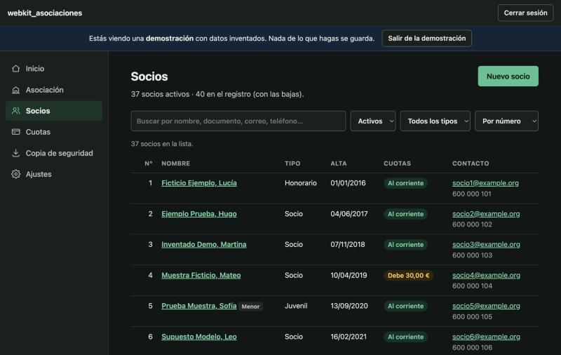
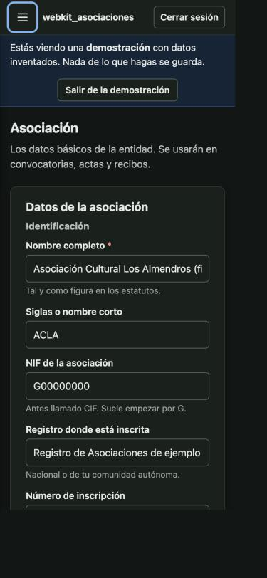

# Agora

La gestión de la asociación **ABIES**: socios y cuotas, tesorería, facturas, IVA, presupuestos, actividades, actas, obligaciones, documentos e informes. Antes se llamaba «ABIES · Gestión» (repositorio `webkit_asociaciones`); su plan dentro de SweetSuite está en `AGORA.md`, en la carpeta de apps.

| Inicio | Socios | Actividades | Móvil (tema oscuro) |
|---|---|---|---|
|  |  |  |  |

*(Capturas de la versión anterior, con datos inventados.)*

## Dentro de SweetSuite

Agora vive dentro de **SweetSuite** y solo la tiene la cuenta de empresa **ABIES** (`cuentas.json`):

- **Se entra por SweetSuite**, con las dos llaves de la empresa: ABIES y su contraseña, y el representante y la suya. SweetSuite le da a Agora su secreto, quién entra y su **cargo**. Abierta sola, fuera de SweetSuite, se va a SweetSuite.
- **El cargo lo pone la Administración** en `cuentas.json` (`"cargos": { "alberto": "Presidencia" }`). Todos ven todo y cada cargo modifica lo suyo:
  - Tesorería: cuotas, tesorería, facturas, IVA y presupuestos.
  - Secretaría: asociación, socios, actas, obligaciones, documentos y textos de la memoria.
  - Vocalía: actividades.
  - Presidencia y vicepresidencia: todo. Presidencia, además, hace lo que hacía la cuenta de administración.
  - Coordinación, o sin cargo: solo ver.
- **Los permisos los hace cumplir la app, no el cifrado:** quien tiene la cuenta de ABIES podría leerlo todo.
- **Registro de cambios:** cada cambio queda firmado («Alberto · Presidencia») en **Actividad** y en cada ficha.
- El bloqueo por inactividad, la contraseña, la clave de recuperación, Bloquear y Cerrar sesión son los de SweetSuite. El tema es el de SweetSuite; el color de acento, de cada uno.

## Dónde están los datos

De momento, **en este dispositivo**: un bloque cifrado (AES-256-GCM, PBKDF2-SHA256) con el secreto de Agora de la cuenta, en IndexedDB, y los adjuntos aparte, cifrados con la misma llave. Agora no se conecta a ningún servidor.

Lo siguiente (fase B de `AGORA.md`) es guardarlo en el repositorio privado `Agora-Data`, con un token por representante y mezclando registro a registro, como Solvento e Ironrack.

## Limitaciones (léelas)

- **No es asesoramiento legal ni fiscal.** Donde la aplicación toca normativa (Ley Orgánica 1/2002 de asociaciones, RGPD, obligaciones contables y fiscales), lo hace de forma orientativa. Verifica siempre con una asesoría.
- **Calendario de obligaciones:** fechas orientativas, editables; verificad con la asesoría qué os afecta.
- **Tesorería por criterio de caja** (el dinero cuenta cuando entra o sale, con el IVA incluido). Las cuentas anuales formales pueden necesitar otro criterio.
- **Las cuentas del ejercicio son un informe para la asamblea, no las cuentas anuales oficiales.** La agrupación en el modelo de entidades sin fines lucrativos es una aproximación orientativa.
- **La ayuda del IVA es orientativa.** Suma lo que hay en las facturas; no calcula la prorrata ni presenta nada.
- **Extractos del banco:** se leen CSV y Excel moderno (.xlsx). Los .xls antiguos hay que guardarlos antes como .xlsx o .csv.
- **Documentos adjuntos:** máximo 10 MB por archivo (configurable). Necesitan IndexedDB.

## Privacidad y RGPD

La asociación es responsable de los datos de sus socios. En **Ajustes → Privacidad** hay una lista de buenas prácticas: quién accede, contraseñas, copias y conservación de datos.

## Para desarrollar

Se prueba con el servidor de desarrollo de SweetSuite (`tools/dev/servidor.py`, en la raíz), entrando como la empresa ABIES. Las pruebas de la lógica solo necesitan [Node.js](https://nodejs.org) 20 o posterior:

```bash
npm test   # dinero, fechas, NIF/IBAN, cifrado, copias, socios, cuotas, tesorería…
```

Cómo está organizado el código: ver [CONTEXT.md](CONTEXT.md) (escrito antes de entrar en SweetSuite).

## Licencia

**Software privativo. Todos los derechos reservados.** Ver [LICENSE](LICENSE).
