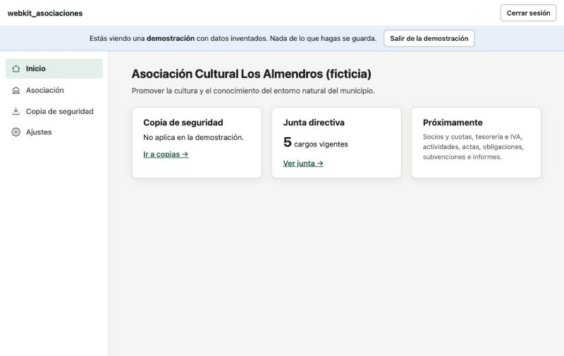
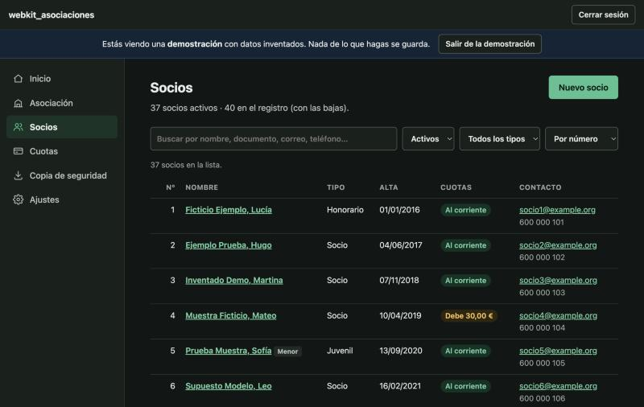
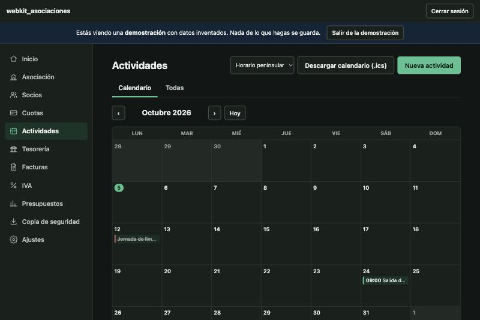
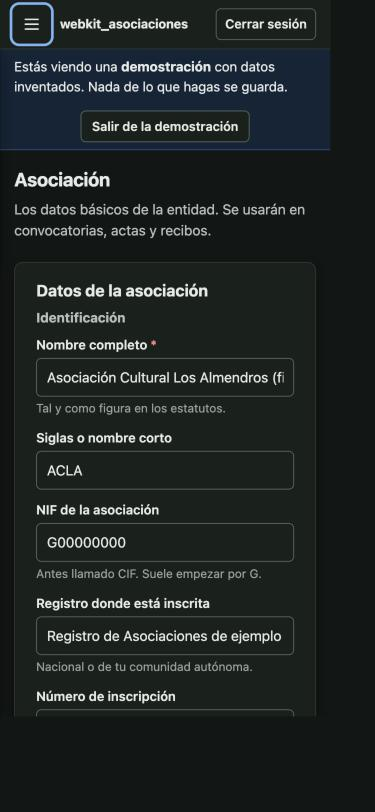

# Agora

La gestión de la asociación **ABIES**: socios, admisiones y cuotas, actividades, actas, obligaciones, documentos e informes. El dinero (tesorería, facturas, IVA, presupuestos y subvenciones) se lleva en **Solvento** desde que Tesorería lo lleva allí (ver «El dinero, a Solvento»). Antes se llamaba «ABIES · Gestión» (repositorio `webkit_asociaciones`); su plan dentro de SweetSuite está en `AGORA.md`, en la carpeta de apps.

| Inicio | Socios | Actividades | Móvil (tema oscuro) |
|---|---|---|---|
|  |  |  |  |

*(Capturas de la versión anterior, con datos inventados.)*

## Dentro de SweetSuite

Agora vive dentro de **SweetSuite** y solo la tiene la cuenta de empresa **ABIES** (`cuentas.json`):

- **Se entra por SweetSuite**, con las dos llaves de la empresa: ABIES y su contraseña, y el representante y la suya. SweetSuite le da a Agora su secreto, quién entra y su **cargo**. También se abre **suelta**, desde su carpeta (ver abajo).
- **El cargo lo pone la Administración de SweetSuite**: al editar ABIES, junto a cada representante. Se guarda en `cuentas.json` (`"cargos": { "alberto": "Presidencia" }`) y cuenta desde la siguiente vez que entra. Todos ven todo y cada cargo modifica lo suyo:
  - Tesorería y vicetesorería: cuotas (y, hasta llevar el dinero a Solvento, tesorería, facturas, IVA y presupuestos).
  - Secretaría: asociación, socios y admisiones, actas, obligaciones, documentos y textos de la memoria.
  - Vocalía: actividades.
  - Presidencia y vicepresidencia: todo. Presidencia, además, hace lo que hacía la cuenta de administración.
  - Coordinación, o sin cargo: solo ver.
- **Los permisos los hace cumplir la app, no el cifrado:** quien tiene la cuenta de ABIES podría leerlo todo.
- **Registro de cambios:** cada cambio queda firmado («Alberto · Presidencia») en **Actividad** y en cada ficha.
- El bloqueo por inactividad, la contraseña, la clave de recuperación, Bloquear y Cerrar sesión son los de SweetSuite. El tema es el de SweetSuite; el color de acento, de cada uno.

## Dónde están los datos

Siempre cifrados (AES-256-GCM, PBKDF2-SHA256) con el secreto de Agora de la cuenta, en dos sitios:

1. **En este dispositivo** (IndexedDB), en cuanto cambia algo.
2. **En GitHub**, en el repositorio privado `Agora-Data`, unos segundos después (autoguardado, encendido de serie), con Guardar o ⌘S, o al volver a SweetSuite:
   - `abies-agora.enc`: el documento;
   - `adjuntos/<id>.enc`: cada adjunto, aparte (se baja la primera vez que alguien lo abre);
   - `abies.llavero.json`: el llavero de la cuenta, que lleva SweetSuite.

**Cada representante usa su token** (`ABIES-Nombre-Agora`, fine-grained, solo `Agora-Data`, *Contents: Read and write*), que se pega en Ajustes › Sincronización y se guarda cifrado en su dispositivo.

**Varios a la vez:** si otro miembro de la junta guardó entre medias, se trae lo suyo y se **mezcla registro a registro** (`src/js/datos/mezcla.js`): en cada socio, cuota o factura gana el cambio más reciente; lo borrado deja marca para que no vuelva; la asociación y la configuración se mezclan campo a campo. Así nadie pisa a nadie.

El estado se ve en el pie de la barra lateral («Sincronizado», «Sin subir»…; pulsándolo se sube lo pendiente) y en la tarjeta de Agora del inicio de SweetSuite, con su resumen: socios activos, cuotas pendientes y próxima actividad.

## Novedades en SweetSuite

- **Remesas SEPA:** en Cuotas, «Fichero SEPA para el banco…» hace el XML (pain.008) para cobrar las cuotas domiciliadas. Hace falta el identificador de acreedor SEPA de la asociación (en Asociación) y, de cada socio, su IBAN y su mandato (referencia y fecha). Al emitir las cuotas se puede prorratear a quien entra a mitad de periodo.
- **Facturas rectificativas:** una factura emitida no se toca; se corrige con una rectificativa (serie R), que dice cuál corrige y por qué.
- **Convocatorias:** en Actas › Convocatorias, con orden del día, carta para imprimir, correo (desde tu correo), evento para el calendario y, celebrada la reunión, su acta.
- **Adjuntos:** varios a la vez, arrastrándolos, y vista previa sin descargarlos.

Formato SEPA, plazos de cobro, requisitos de las rectificativas y forma de convocar: verificar con el banco, con asesoría y con los estatutos.

## El dinero, a Solvento

Desde la fase 3 de `TESORERIA.md` (en la carpeta de apps), el dinero de la asociación se lleva en **Solvento**, que solo ve Tesorería.

En **Ajustes › Seguridad › Llevar el dinero a Solvento** (solo quien también tiene Solvento), Agora prepara un paquete (`src/js/logica/traspaso.js`) y SweetSuite se lo lleva a Solvento en memoria. El paquete lleva:
- las cuentas, con su saldo inicial como ajuste;
- los movimientos, y las cuotas e inscripciones cobradas sin movimiento propio;
- los anticipos y reembolsos, como préstamos entre personas;
- las facturas;
- los proyectos y subvenciones, cada uno con su centro de coste.

Solvento enseña lo que va a traer antes de guardarlo. No repite nada si se lleva dos veces y avisa a Agora, que lo apunta (`config.dineroEnSolvento`).

Desde ese momento (fase 5), Agora quita del menú Tesorería, Facturas, IVA y Presupuestos, e Inicio, Obligaciones e Informes dejan de enseñar el dinero. Los datos no se borran: siguen guardados en Agora, sin verse.

Desde entonces (fase 4, `src/js/datos/cobros.js`), cada cuota o inscripción cobrada es un ingreso en Solvento:
- tras cada cambio, Agora manda la lista entera de esos ingresos;
- Solvento la deja igual: descobrar una cuota quita su ingreso;
- si Solvento no está abierto, SweetSuite lo abre por detrás;
- si no se puede en ese momento, queda pendiente.

Cobrar o descobrar necesita tener Solvento, es decir, ser Tesorería. Si quien cobra aún no ha pegado su token de Solvento, Solvento está en modo lectura: el ingreso se queda esperando, Agora lo avisa y se apunta al pegar el token (o cuando entra otra persona de Tesorería).

## Admisiones

En **Socios › Admisiones** (`src/js/logica/admisiones.js`) se apunta quién pide hacerse socio. La junta decide: **Admitir** le da de alta con el número siguiente y la fecha del acuerdo como fecha de alta, y enlaza la solicitud con su ficha; **No admitir** guarda la fecha, el motivo y quién lo acordó, y se puede reabrir o borrar. Avisa si quien lo pide ya es socio o ya lo pidió. El procedimiento lo fijan los estatutos.

## Traer los datos de antes

En **Ajustes › Seguridad › Traer una copia de antes** (solo Presidencia), el archivo `.json` que descargabas en «ABIES · Gestión». Se abre con lo que pedía entonces (nombre, cargo y las dos contraseñas, o la contraseña de una copia antigua) y se junta con lo que ya haya: no se borra nada, y en la asociación y la configuración manda la copia. Basta con hacerlo una vez: llega al resto de la junta por GitHub.

## Limitaciones (léelas)

- **No es asesoramiento legal ni fiscal.** Donde la aplicación toca normativa (Ley Orgánica 1/2002 de asociaciones, RGPD, obligaciones contables y fiscales), lo hace de forma orientativa. Verifica siempre con una asesoría.
- **Calendario de obligaciones:** fechas orientativas, editables; verificad con la asesoría qué os afecta.
- **Tesorería por criterio de caja** (el dinero cuenta cuando entra o sale, con el IVA incluido). Las cuentas anuales formales pueden necesitar otro criterio.
- **Las cuentas del ejercicio son un informe para la asamblea, no las cuentas anuales oficiales.** La agrupación en el modelo de entidades sin fines lucrativos es una aproximación orientativa.
- **La ayuda del IVA es orientativa.** Suma lo que hay en las facturas; no calcula la prorrata ni presenta nada.
- **Extractos del banco:** se leen CSV y Excel moderno (.xlsx). Los .xls antiguos hay que guardarlos antes como .xlsx o .csv.
- **Documentos adjuntos:** máximo 10 MB por archivo (configurable). Necesitan IndexedDB.
- **Dos cambios al mismo registro a la vez:** se queda el más reciente (el otro sigue en el registro de cambios, pero no se fusionan campo a campo dentro de un socio o una factura).

## Privacidad y RGPD

La asociación es responsable de los datos de sus socios. En **Ajustes → Privacidad** hay una lista de buenas prácticas: quién accede, contraseñas, copias y conservación de datos.

## Suelta

Abrir su carpeta, `apps/agora/` (en la web, <https://acasadovadillo.github.io/SweetSuite/apps/agora/>), lleva a SweetSuite con `?app=agora`: la entrada sale con el logo, el nombre y el color de Agora, y al entrar se abre solo Agora, sin el inicio ni las demás apps. La cuenta, la contraseña y los datos son los mismos. «Tu cuenta», en su menú, abre la contraseña y la clave de recuperación. Se puede instalar sola en el móvil (`manifest.json`).

## Estructura

```
index.html      la página (SweetSuite la abre en un marco)
manifest.json   para instalarla suelta
img/            el icono (la hoja de ABIES)
src/css/        estilos
src/js/         nucleo/ (interfaz, cifrado, fechas…), logica/ (socios, cuotas, SEPA…),
                datos/ (esquema, mezcla, GitHub…), modulos/ (cada sección)
tests/          las pruebas de la lógica (node --test)
docs/           capturas
```

## Para desarrollar

Se prueba con el servidor de desarrollo de SweetSuite (`tools/dev/servidor.py`, en la raíz), entrando como la empresa ABIES. Las pruebas de la lógica solo necesitan [Node.js](https://nodejs.org) 20 o posterior:

```bash
npm test   # dinero, fechas, NIF/IBAN, cifrado, copias, socios, cuotas, tesorería…
```

Cómo está organizado el código: ver [CONTEXT.md](CONTEXT.md) (escrito antes de entrar en SweetSuite).

## Licencia

**Software privativo. Todos los derechos reservados.** Ver [LICENSE](LICENSE).
